# webserv · Post Office

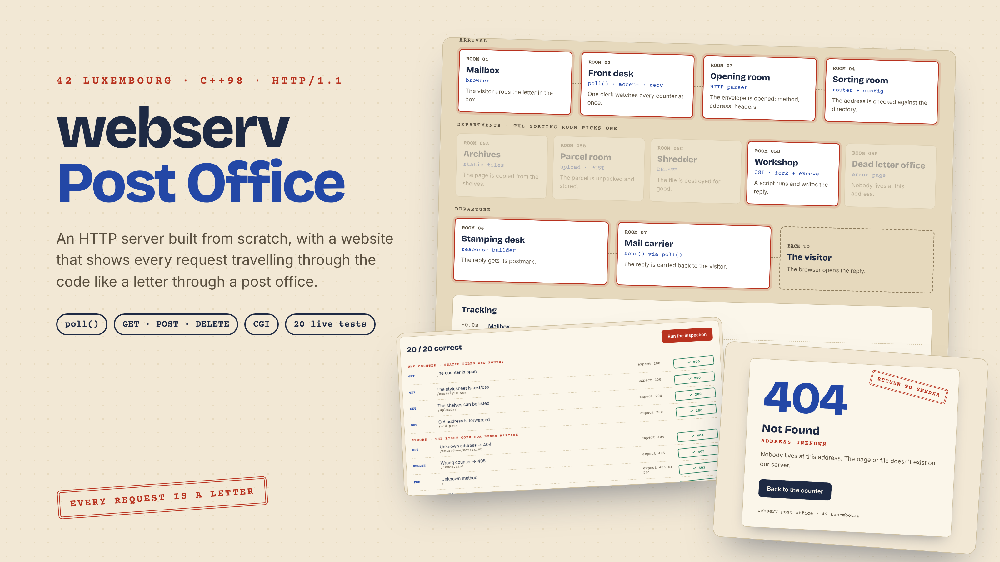

**webserv** is an HTTP/1.1 server written from scratch in C++98 for the 42 Common Core
(by smetz, fabdelba and dvogli). The website it serves is designed as a **post office**:
every request is a letter, and every room of the post office is one part of the server's code.
The site isn't only decoration. It is also the team's **live test tool**: every page sends real
requests to the server and shows the real answer, so a broken feature shows up immediately.

Design and front-end: **fabdelba**.

---

## The idea

| Post office | Server |
|---|---|
| 📮 Mailbox | the browser sends the request |
| 🛎️ Front desk | `poll()` · `accept()` · `recv()`: one clerk watches every counter at once |
| ✉️ Opening room | the HTTP parser reads method, address, headers |
| 🗂️ Sorting room | the router checks the address against the config |
| 🏛️ Departments | static files · uploads · DELETE · CGI · error pages |
| 🖋️ Stamping desk | the response gets its status code (the postmark) |
| 🚲 Mail carrier | `send()` through `poll()` carries the reply back |

On the home page, the visitor picks a request and watches an envelope travel room by room.
The departments that are not on its route fade out, a tracking list fills up, and a postcard
comes back stamped with the server's real status code.

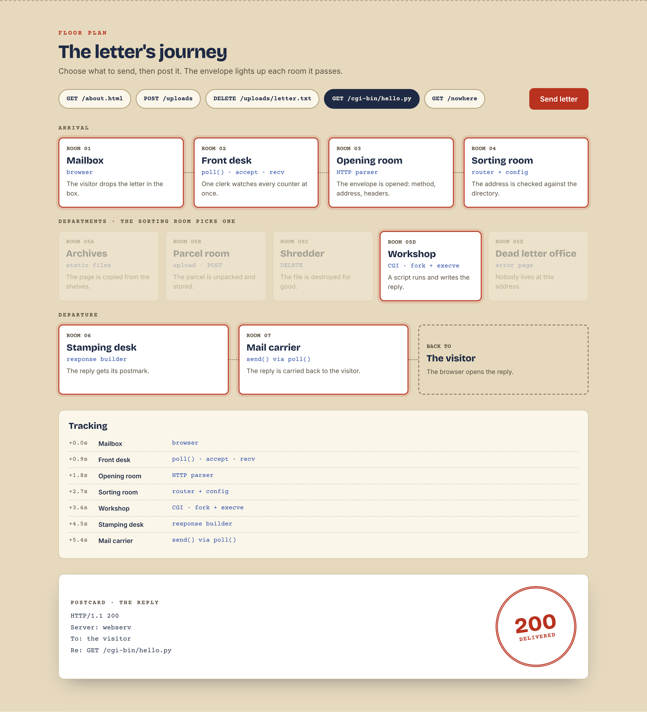

---

## Design choices

- **Palette:** every color comes from a real object. Kraft paper `#F2E8D5` (background),
  dark ink `#1E2A44` (text), fountain-pen blue `#2347A6` (technical details),
  stamp red `#B8321F` (accents and actions).
- **Typography:** three fonts, three jobs. *Bricolage Grotesque* for titles,
  *Courier Prime* (typewriter) for labels, postmarks and code, *Inter* for reading.
- **Details:** perforated stamp edges drawn with a CSS `radial-gradient`, dashed "cut here" lines,
  slightly tilted cards and stamps (placed by hand), a bobbing envelope (`@keyframes`),
  and a postmark that "hits" the paper.
- **Status codes as postmarks:** `200 DELIVERED`, `201 RECEIVED`, `404 ADDRESS UNKNOWN`,
  `405 WRONG COUNTER`, `413 TOO HEAVY`, `504 TOO SLOW`…
- **Built with plain HTML, CSS and JavaScript:** no framework, no build step. It is served
  by our own C++ server, which also proves that it sends the right `Content-Type` for every file.

---

## The pages

| Page | What it does |
|---|---|
| **Counter** (home) | the letter's journey through the post office |
| **Send a parcel** | drag & drop upload (`POST`, `multipart/form-data`) |
| **Mailroom** | lists the uploaded files from the server's autoindex, and shreds them with `DELETE` |
| **Workshop** | runs CGI scripts (Python and bash) with a query string or a body, a slow script (timeout → 504), and the bonus: a visit counter with cookies and sessions |
| **Inspections** | 20 live tests in one click, each with a green or red stamp |
| **Terminal** | the requests a browser can't send (broken headers, `nc`, unit tests), ready to copy |
| **About** | the rooms and the code behind them, and the team |
| **Error pages** | 400, 403, 404, 405, 413, 500, 502, 504: the official HTTP message as the title, the post office name underneath |

### Send a parcel and the Mailroom
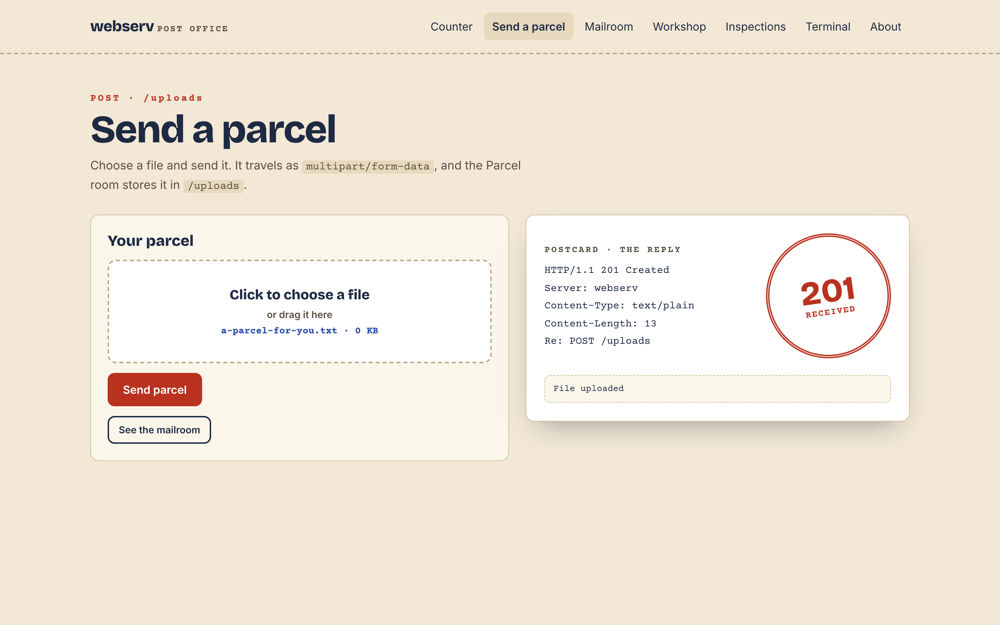
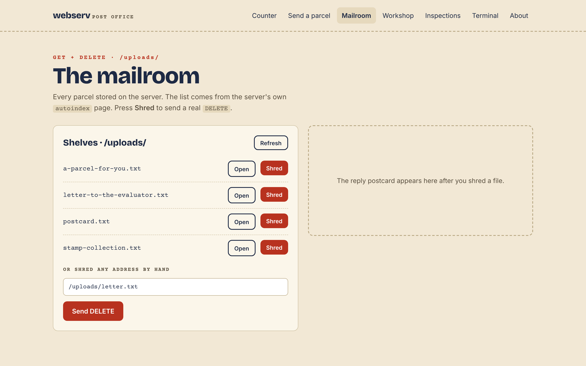

### Workshop (CGI)
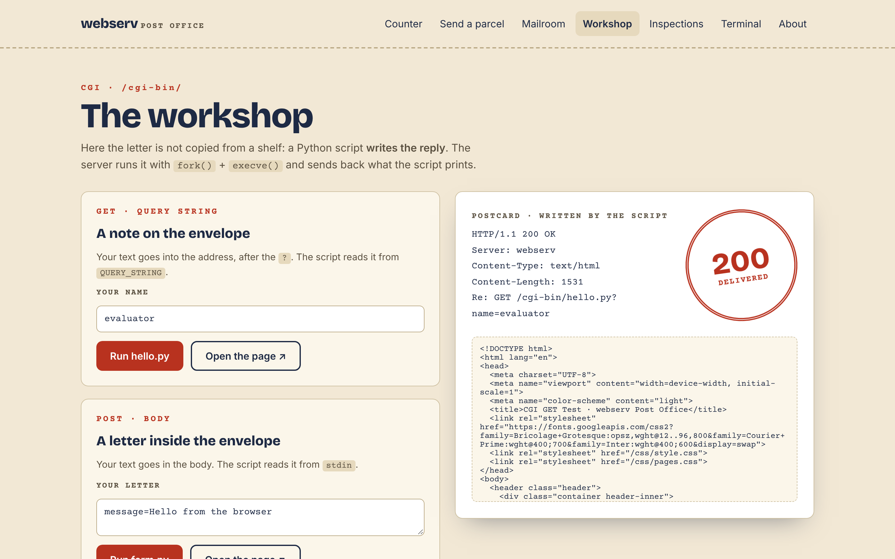

### Bonus: cookies, sessions and two CGI languages
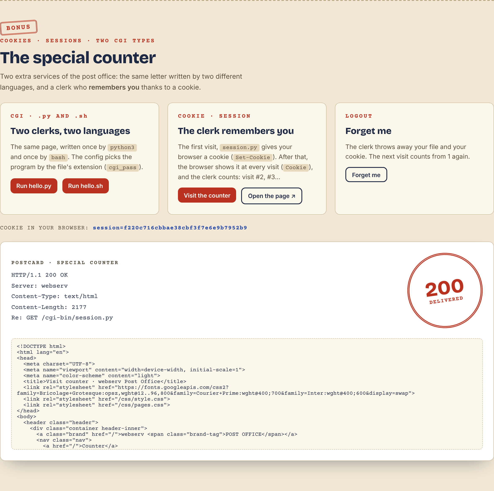
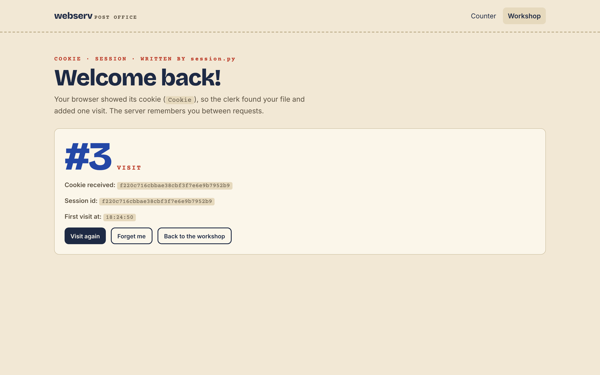

### Inspections: 20 live tests
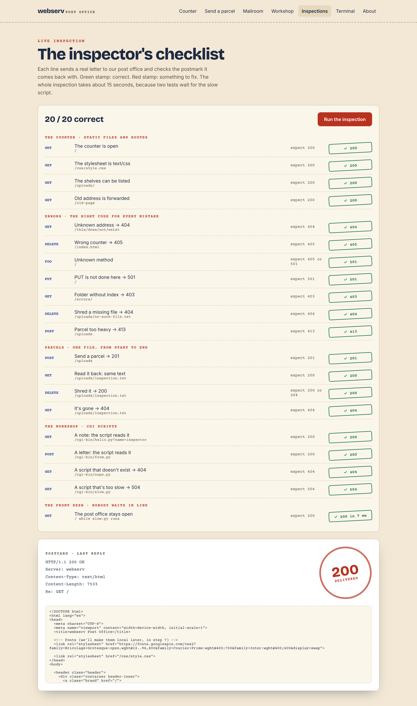

### Terminal
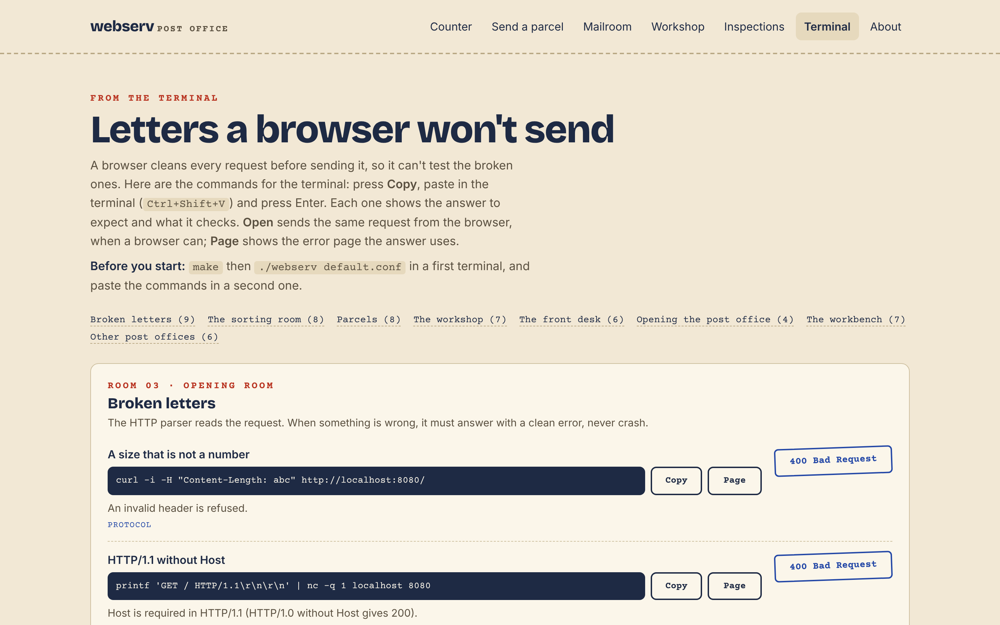

### Error pages
<p>
  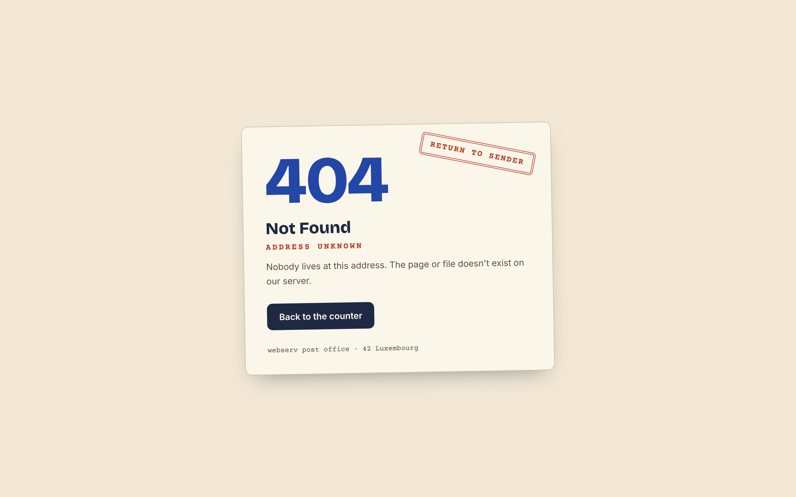
  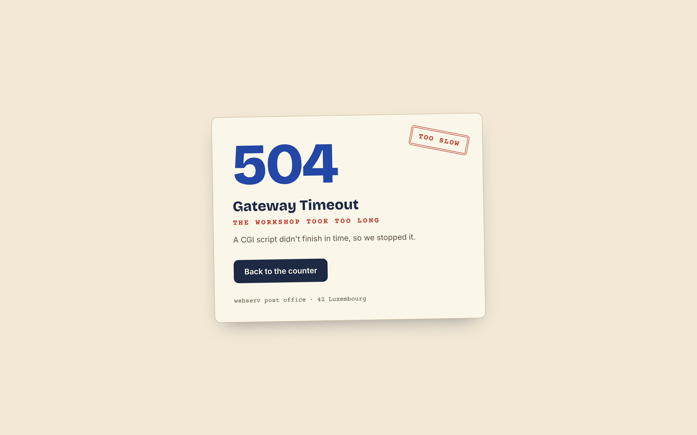
</p>

### On a phone
<p>
  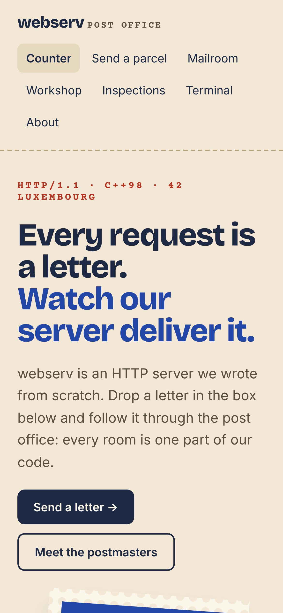
  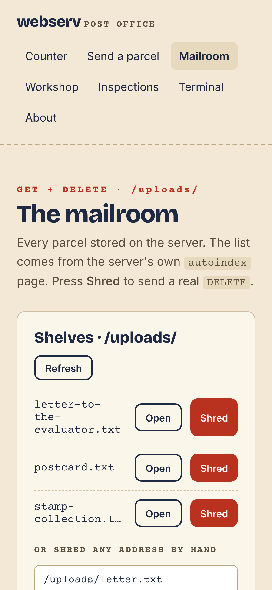
  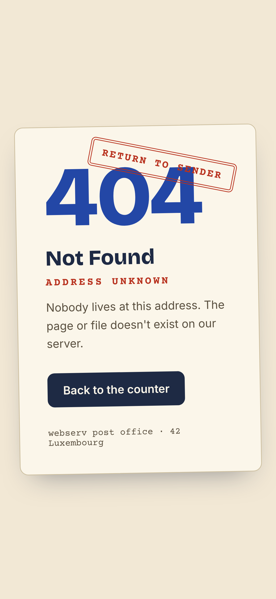
</p>

---

## Run it

```bash
make
./webserv default.conf
```
Then open <http://localhost:8080>.
